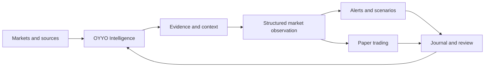
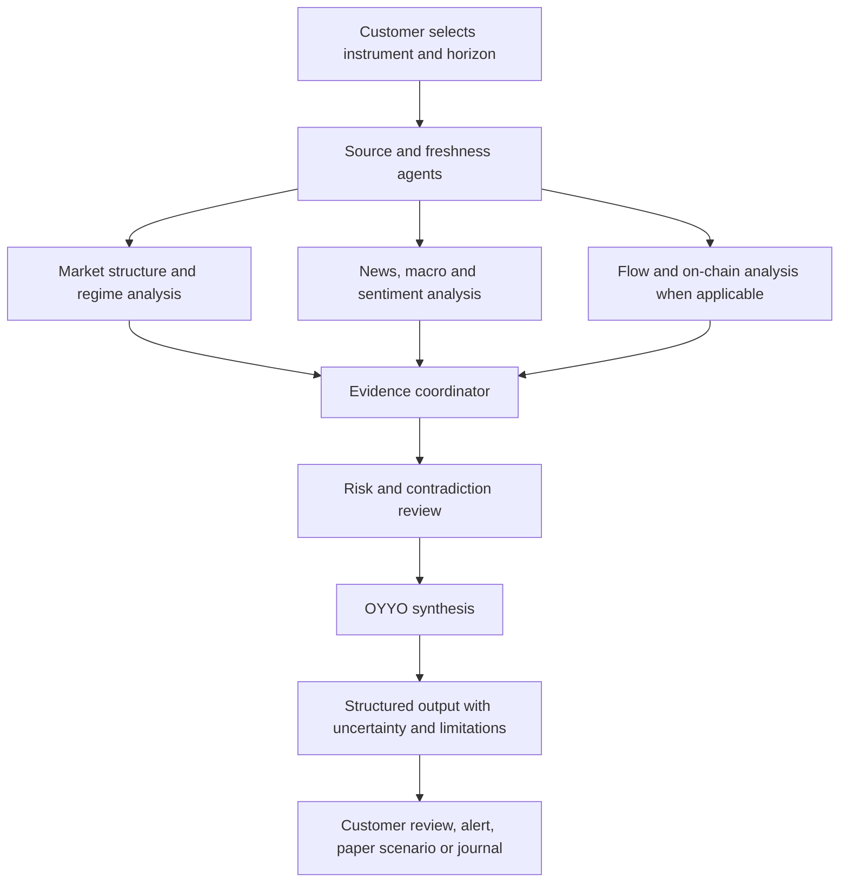
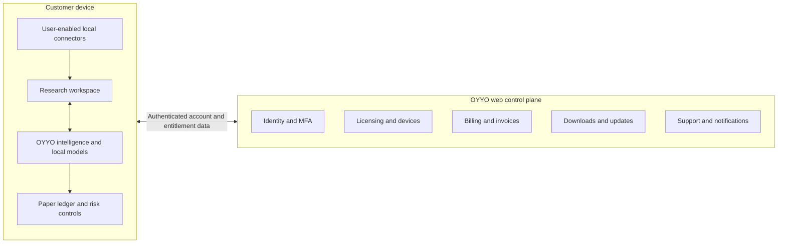

# OYYO Trade Signals

### Intelligent market understanding. Evidence-rich outputs. Decisions remain yours.

**Crypto · Gold · Forex · Indices · Research · Alerts · Paper Trading · Risk Intelligence**

[Website](https://oyyosignals.trade) · [How it works](docs/HOW-IT-WORKS.md) · [Intelligence engine](docs/AGENTS-AND-INTELLIGENCE.md) · [User guide](docs/USER-GUIDE.md) · [FAQ](docs/FAQ.md)

**Application version `0.2.0` · Documentation version `1.0.0` · Made in UAE 🇦🇪 · Dubai-IT**

> [!IMPORTANT]
> OYYO Trade Signals is market-intelligence and decision-support software. It does not provide investment advice or personal recommendations, is not a broker, and does not place trades for you. Trading involves substantial risk of loss. Simulated or past results do not indicate future results.

OYYO Trade Signals brings market research, structured signals, watchlists, alerts, strategy work, paper trading, journaling and risk controls into one intelligent workspace. Instead of showing an unexplained label, OYYO builds an evidence-rich market observation with sources, freshness, supporting and opposing evidence, uncertainty, limitations, model identity and provenance.

This repository is the complete public customer information center for OYYO Trade Signals. It explains the product, intelligence system, coordinated agents, models, connectors, versions, workflows, privacy boundaries and wider OYYO ecosystem. The proprietary application source and private runtime remain protected.

## One workspace for the full research loop

OYYO helps customers move from scattered information to a structured, reviewable output:

- Organize crypto, gold, forex and index instruments in persistent watchlists.
- Bring price context, market sessions, news, macro events, sentiment and permitted sources into one research flow.
- Compare supporting and opposing evidence instead of hiding disagreement.
- Record uncertainty, limitations, source freshness, model version and provenance.
- Create user-configured alerts and research scenarios.
- Test ideas with risk-limited paper tickets, transactions and positions.
- Review decisions in strategy notes and the research journal.
- Use local notional limits, daily-loss limits and the paper kill switch.

## How OYYO understands markets

The intelligence layer uses coordinated specialist responsibilities. Each specialist examines a bounded part of the question; the evidence coordinator combines compatible findings; risk and contradiction review searches for missing, stale or opposing information; and OYYO produces one readable result.

[Explore the complete agent and intelligence flow](docs/AGENTS-AND-INTELLIGENCE.md).

## The OYYO signal contract

Every OYYO market observation is designed around thirteen required fields:

| Context | Evidence | Accountability |
| --- | --- | --- |
| Timestamp | Supporting evidence | Model version |
| Horizon | Opposing evidence | Provenance |
| Instrument | Sources | Limitations |
| Market-state label | Data freshness | Required notice |
| Uncertainty |  |  |

Market-state labels are descriptive: `bullish`, `bearish` or `neutral`. Provenance is explicit: `simulated`, `paper` or `live-data`. The required notice is **Informational market analysis — not an instruction to transact.**

## What makes OYYO Trade Signals different

| Fragmented workflow | OYYO Trade Signals |
| --- | --- |
| Charts, notes, alerts and paper records spread across tools | One connected research workspace |
| A label without its reasoning | Evidence, counter-evidence, uncertainty and limitations together |
| Model output with unclear identity | Versioned model and provenance attached to the record |
| Stale data that looks current | Source and freshness information built into the output |
| Paper results separated from research | Research, paper activity, positions and journal connected |
| Risk remembered informally | Deterministic notional, daily-loss and paper kill-switch controls |
| One opaque model response | Coordinated specialist analysis, contradiction review and synthesis |
| Cloud-first custody of every workflow | Customer-controlled local workspace with a separated account control plane |

OYYO's advantage is not a promise that a market can be predicted perfectly. It is a stronger decision-support process: more context, visible disagreement, traceable versions, explicit uncertainty and a disciplined path from research to review.

## Customer-controlled architecture

The installed application owns the customer research experience. The web control plane handles identity, licensing, billing, downloads, notifications, consent records, support and account administration. Local connector credentials belong in the device operating system's secure store, not in the OYYO cloud.

## Product functionality

### Research and intelligence

- Multi-market watchlists and reference quotes.
- Structured research records and strategy notes.
- Coordinated market, source, evidence, risk and synthesis intelligence.
- Source-linked context, freshness and provenance.
- Supporting and opposing evidence with uncertainty and limitations.
- Versioned model and output identity.

### Alerts, simulation and review

- Locally evaluated alert rules.
- Risk-limited paper tickets.
- Append-only paper transactions and derived positions.
- Notional and daily-loss controls.
- Paper kill switch.
- Research journal for decisions, outcomes and lessons.

### Account and access

- Secure account, email verification and supported social sign-in.
- TOTP multi-factor authentication.
- 72-hour demo that does not auto-convert.
- Annual plans, add-ons and bundles.
- Device enrollment and revocation.
- Account portal, support, privacy and consent controls.
- Downloads, releases, invoices and billing management.

## Connectors

| Connector family | How OYYO uses it |
| --- | --- |
| Market and reference data | Charts, watchlists, market context, freshness and local alerts |
| News and macro sources | Timestamped, source-linked event context |
| Sentiment intelligence | Summaries with source and uncertainty information |
| On-chain and flow intelligence | Observational network and large-flow context |
| Local model runtimes | Device-qualified analysis with exact model identity |
| Notifications | Delivery of customer-configured alerts and account events |
| Identity and billing | Secure web account and licence lifecycle |

Read the [connector and privacy guide](docs/CONNECTORS.md).

## Versions that stay understandable

OYYO versions the application, public documentation, signal schema, model artifact, model workflow, catalog, API/SDK and legal consent separately. This makes it possible to know exactly which product, model and contract produced an output.

[Read the versioning guide](docs/VERSIONING.md).

## OYYO ecosystem

| Repository | Connection to Trade Signals |
| --- | --- |
| [OYYO ONE AI](https://github.com/vpicciuolo/oyyo-one-ai) | Main OYYO product and ecosystem documentation hub |
| [OYYO Models](https://github.com/vpicciuolo/oyyo-models) | Model cards, provenance, hardware requirements and capability records |
| [OYYO Benchmark](https://github.com/vpicciuolo/oyyo-benchmark) | Model/runtime quality, reliability and hardware evaluation |
| [OYYO Agents](https://github.com/vpicciuolo/oyyo-agents) | Specialist responsibilities and coordinated agent structure |
| [OYYO Teams](https://github.com/vpicciuolo/oyyo-teams) | Collaboration, review and handoff patterns |
| [OYYO Task Library](https://github.com/vpicciuolo/oyyo-task-library) | Guided research and business workflows |
| [OYYO Catalogs](https://github.com/vpicciuolo/oyyo-catalogs) | Independently versioned catalog content and integrity metadata |
| [OYYO SDK](https://github.com/vpicciuolo/oyyo-sdk) | Public developer interfaces and integration documentation |
| [OYYO NotzUP](https://github.com/vpicciuolo/oyyo-notzup) | Separate OYYO capture and knowledge product |

## Documentation

- [How OYYO Trade Signals works](docs/HOW-IT-WORKS.md)
- [Agents and intelligence engine](docs/AGENTS-AND-INTELLIGENCE.md)
- [Product functionality](docs/FEATURES.md)
- [Signals, models and provenance](docs/SIGNALS-AND-MODELS.md)
- [Versioning](docs/VERSIONING.md)
- [Connectors and privacy](docs/CONNECTORS.md)
- [Customer user guide](docs/USER-GUIDE.md)
- [Frequently asked questions](docs/FAQ.md)
- [Security reporting](SECURITY.md)

Visit **[oyyosignals.trade](https://oyyosignals.trade)**.

Public visibility does not make the proprietary OYYO Trade Signals platform open source. Individual linked artifacts retain their own explicit terms.

**Copyright © 2026 OYYO · HRN INNOVATION TECHNOLOGIES LTD. All rights reserved.**
