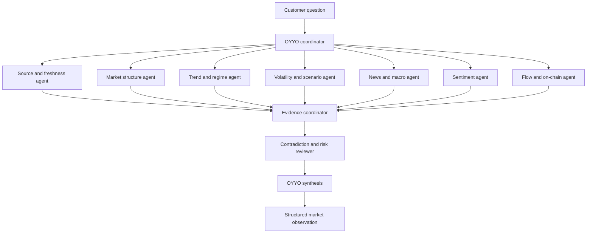
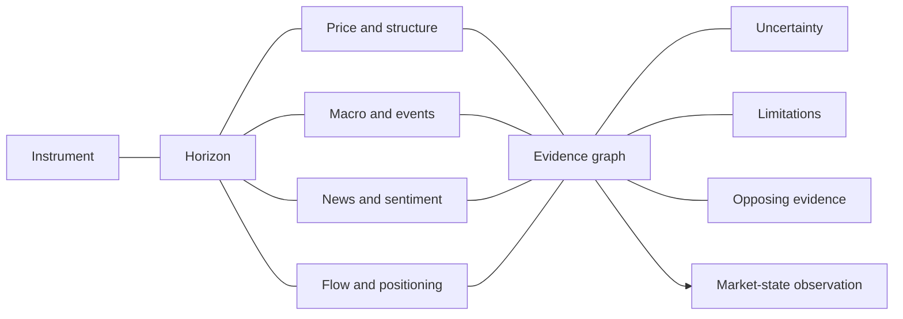

# OYYO agents and market intelligence

OYYO intelligence is organized as a coordinated team rather than a single opaque response. Each agent responsibility has a defined input, bounded analysis task and expected contribution. The coordinator assembles evidence; the review layer challenges it; synthesis creates the customer-facing output.

## Ask OYYO conversation layer

On Android 0.8.0, OYYO-SIGNAL-TINY-ALL 2026.11.1 provides a local conversational entry point. It converts a plain-language goal into either an explanation, a follow-up question or a typed proposal for analysis, a paper plan or an alert. A proposal is never treated as an executed action: the customer confirms it and deterministic application code validates the supported symbol and required fields.

## Agent collaboration map

Only relevant specialists are used for a given instrument and question. On-chain analysis can be relevant to a crypto asset but not to every forex or index question.

## Responsibilities

| Responsibility | Contribution |
| --- | --- |
| OYYO coordinator | Understands scope, decomposes the question and keeps horizon/instrument consistent |
| Source and freshness | Validates source identity, timestamps, gaps and age |
| Market structure | Examines price structure, levels, sessions and market context |
| Trend and regime | Describes directional and regime evidence across the selected horizon |
| Volatility and scenarios | Frames dispersion, instability and alternative paths |
| News and macro | Connects source-linked events and macro context to the scope |
| Sentiment | Summarizes permitted sentiment inputs with uncertainty |
| Flow and on-chain | Adds observational flow/network evidence where applicable |
| Evidence coordinator | Groups compatible evidence and keeps disagreement visible |
| Contradiction and risk reviewer | Challenges stale data, overconfidence, missing counter-evidence and limitations |
| OYYO synthesis | Produces the readable output and preserves provenance |

## How OYYO reads markets

OYYO does not “understand” a market from one number. It builds a context graph around the customer's question:

Sources and freshness explain what OYYO saw; supporting and opposing evidence explain why the observation was formed; uncertainty and limitations explain what remains unresolved.

## Safeguards

- Specialists work within the selected instrument and horizon.
- Source identity and freshness are preserved.
- Opposing evidence is required.
- Review can return work for correction before synthesis.
- Model and workflow versions remain attached to the record.
- Simulated, paper and live-data provenance are never merged silently.
- No specialist turns the output into a personal recommendation or transaction instruction.

The reusable public role catalog is documented in [OYYO Agents](https://github.com/vpicciuolo/oyyo-agents), collaboration patterns in [OYYO Teams](https://github.com/vpicciuolo/oyyo-teams), and model qualification in [OYYO Models](https://github.com/vpicciuolo/oyyo-models) and [OYYO Benchmark](https://github.com/vpicciuolo/oyyo-benchmark).
