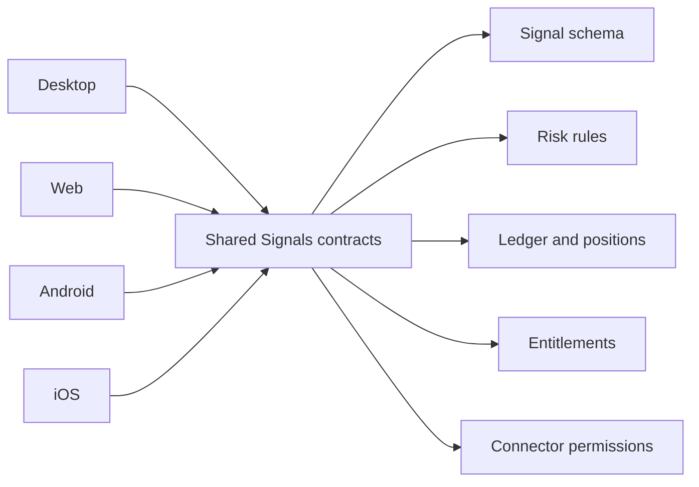

# Web, desktop and mobile apps

OYYO Trade Signals uses one product contract across web, desktop and mobile while adapting the interface to each device.

## Platform map

| Experience | Primary role |
| --- | --- |
| Web | Product information, secure sign-in, account, demo/licence, billing, invoices, downloads, devices, support and browser-accessible research surfaces |
| Desktop | Full multi-window and multi-screen trader workspace, advanced charts, scanners, research, strategy lab, paper/manual workflows, local models, connectors, risk and journal |
| Android | Standalone touch-first workspace for markets, research records, paper activity, strategy notebook, local alerts, journal, risk controls, account and linked installations |
| iOS | Standalone mobile workspace using the same portable product contracts and device-appropriate interaction model |

## Shared product contract

Shared contracts keep signal fields, risk rules, mode names, entitlement semantics and connector permissions consistent. Layouts remain native to the device.

## Web account and control plane

The web experience manages identity, MFA, licences, devices, downloads, billing, invoices, consent records, notifications and support. It does not need custody of venue credentials or customer assets.

## Desktop workspace

Desktop is optimized for information density: saved workspaces, detachable or multi-panel views, several charts, watchlists, signal evidence, news, scanners, transactions, positions, risk and journal. Local models and customer-enabled connectors run within the installed runtime boundary.

## Mobile workspace

Mobile is not a remote-control-only companion. It provides its own local workspace and account-aware tools. Phone layouts prioritize one focused task at a time while preserving the same research, paper, risk and provenance concepts.

## Continuity and devices

A customer account can show enrolled installations and their versions. Cross-device continuity is authenticated and permission-bound. An enrolled device is not automatically authorized to command another device, submit an intent or access local secrets.

## Updates and release identity

Downloads and release records identify platform, architecture, version, channel and artifact. Customers should install only from the official OYYO Signals account/download experience and verify the displayed release identity.
