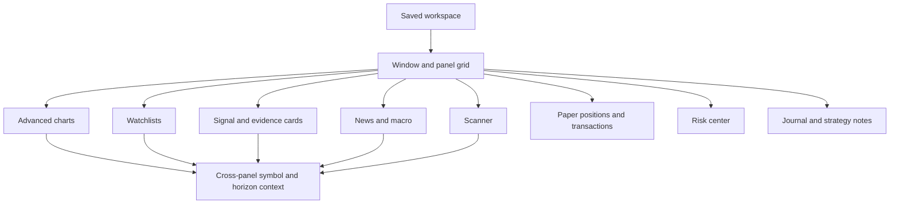

# Advanced charts and trader workspaces

OYYO Trade Signals provides a configurable multi-window research environment on **web and desktop** for customers who need several markets, time horizons and evidence sources visible at once. Desktop adds native detachable windows, multi-screen depth, local models and local connectors; the web application provides the configurable workspace directly in a supported browser.

For configuration examples, linked-context behavior and a fair comparison with chart-first platforms, see the [dedicated multi-window workspace guide](MULTI-WINDOW-WORKSPACE.md).

## Workspace architecture

## Multi-window workflow

Customers can organize several panels around one instrument or compare several instruments. Desktop and web layouts prioritize multi-panel and multi-screen work; mobile reorganizes the same product areas into touch-first navigation rather than shrinking the desktop grid.

Workspace uses include:

- one instrument across multiple horizons;
- correlated or competing markets side by side;
- chart, evidence, news and journal together;
- scanner results alongside detailed research;
- paper positions, transactions and risk controls visible during review;
- saved layouts for different markets or strategies.

## Advanced charts

Chart workspaces support market/session context, multiple horizons, overlays and indicators, drawings, saved views, linked symbol context and direct movement between chart, research record, alert, paper ticket and journal.

A chart displays data; it does not establish source quality or remove the need to review timestamps, gaps, corporate/venue events, session definitions and provider methodology.

## Scanner and market discovery

The scanner helps customers filter configured markets by selected conditions. Results are research candidates, not recommendations. Scanner output should be rechecked against source freshness, market structure, opposing evidence, liquidity and risk.

## Signal and evidence panel

The signal panel presents the complete thirteen-field contract rather than a standalone label. Customers can inspect sources, freshness, supporting and opposing evidence, uncertainty, limitations, model/workflow version and provenance before using an observation elsewhere in the workspace.

## Strategy lab

The strategy workspace records entry, exit and invalidation rules, scenarios, observations and paper results. It supports repeatable research discipline; it does not convert backtests or paper outcomes into guaranteed live performance.

## Transactions, positions and risk

The activity workspace presents orders, fills, fees and derived positions for supported modes. The Risk Center applies deterministic limits before an eligible ticket or intent proceeds. The journal connects the original rationale to the later outcome.

## Keyboard, accessibility and mobile

Public and workspace interfaces use labeled controls, visible focus, reduced-motion support and responsive layouts. Desktop favors speed and density; mobile favors clear touch targets, focused tasks and full-detail drill-down.
