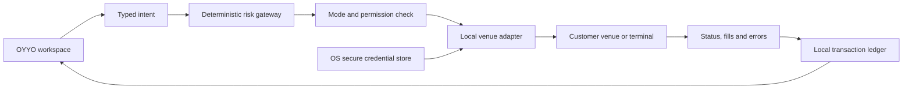

# Broker, terminal and crypto-exchange connectors

OYYO Trade Signals uses a customer-controlled local adapter model for eligible venues and data providers. Connectors link the installed runtime to accounts the customer owns and authorizes. OYYO does not take custody of funds, assets, private keys or venue credentials.

## Connector architecture

## Connector families

### Desktop trading terminals

The connector contract supports locally installed terminal bridges, including customer-managed MT5-compatible workflows where offered for the selected platform and region. The terminal remains the customer's environment; credentials stay local; the adapter exposes account/venue identity, symbol mapping, permissions, health and execution responses.

**Trademark notice:** MetaTrader 5 and MT5 are third-party names associated with MetaQuotes Ltd. OYYO is not affiliated with, sponsored by or endorsed by MetaQuotes. Availability and use are subject to the third-party platform's terms and the customer's broker.

### Crypto exchanges

The venue-adapter contract supports eligible customer-controlled crypto-exchange connections for market data, account state and permitted order workflows. Common exchange categories include spot and derivatives venues; the exact directory shown in the app is authoritative for the customer's region and release.

Examples customers commonly recognize include Binance, Coinbase, Kraken, OKX, Bybit and other compatible venues. Naming an exchange describes an integration category, not endorsement, universal availability or a promise that every product, order type or jurisdiction is supported.

### Broker and market-data APIs

Eligible brokers and specialist data providers can be connected through versioned adapters with explicit scopes. Read-only market/account permissions are separated from order permissions.

## Permission model

| Permission | Purpose |
| --- | --- |
| Market data | Quotes, candles, depth or reference information |
| Account read | Balances, positions and venue status |
| Paper | Local simulation only |
| Manual order | Exact customer-confirmed submission |
| Supervised order | Customer approval of a prepared intent |
| Automatic order | Explicitly enabled strategy inside fixed limits |
| Cancel/close | Separately authorized risk/position action |

A connector receives only the scopes required for the enabled mode. Enabling market data does not grant order permission.

## Safety requirements

- Credentials stay in the operating-system secure store.
- Secret values never enter GitHub, browser code, logs or support messages.
- Symbol, precision, minimum size, order type and venue state are validated.
- Stale data, disconnected adapters and permission changes fail closed.
- Every eligible intent passes deterministic limits.
- Duplicate/replay protection and idempotency protect submissions.
- Status, rejection, partial fill, fee and cancellation information enters the ledger.
- Kill switches exist in OYYO and should also be available at the venue.
- The customer remains responsible for venue terms, taxes, local law and account security.

## Connector availability

The application shows the supported connector directory, permissions and health for the installed version, account, device and region. A website, documentation example or recognizable venue name does not by itself activate a connection or grant order authority.
