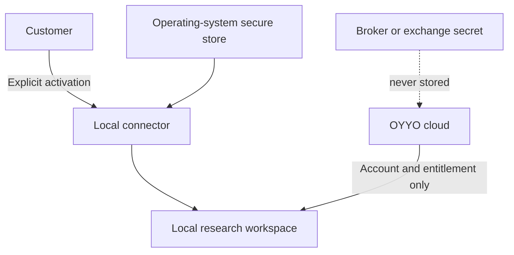

# Connectors, sources and privacy

Connectors bring permitted information into OYYO Trade Signals while preserving source identity, freshness and customer control.

## Connector flow

## Connector families

### Market and reference data

Supports watchlists, price context, charts, session awareness and local alert evaluation. Provider timestamps and freshness remain visible.

### News and macro events

Adds source-linked event context. OYYO distinguishes source reporting from generated interpretation and retains limitations.

### Sentiment intelligence

Summarizes permitted sentiment inputs while preserving source, timestamp and uncertainty information.

### On-chain and flow intelligence

Adds observational network, positioning and large-flow context where relevant. Heuristic labels and incomplete data remain visible as limitations.

### Model runtimes

Runs device-qualified models and records exact model/workflow identity. Local and connected execution remain clearly separated.

### Notifications

Delivers customer-configured alerts and account events. A notification is informational and never authorizes a transaction.

### Identity, licensing and billing

Provides the secure account lifecycle, device enrollment, entitlements, invoices, downloads and support through the web control plane.

## Customer control

Local integration credentials stay in the operating-system secure store. They are not placed in browser code, documentation, support messages or the OYYO cloud. OYYO does not offer a cloud order endpoint and does not custody customer assets or private keys.

OYYO exposes missing, stale, rate-limited or unavailable inputs instead of presenting them as current.
