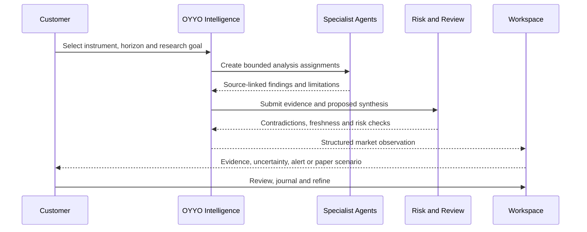
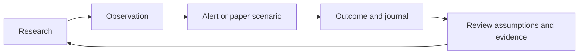

# How OYYO Trade Signals works

OYYO Trade Signals turns a customer-selected market question into a structured, inspectable research output. It combines specialized analysis, source and freshness controls, contradiction review, synthesis, alerts, paper simulation and journaling in one continuous workflow.

## From market question to useful output

## 1. Scope

The customer chooses the instrument, time horizon and research purpose. OYYO keeps the scope attached to the work so evidence from different horizons or instruments is not silently mixed.

## 2. Gather and normalize context

Permitted market, news, macro, sentiment and on-chain sources are normalized into a common research context. Source identity, timestamps and freshness remain visible.

## 3. Coordinate specialist intelligence

OYYO delegates bounded work to specialist responsibilities such as market structure, trend/regime, volatility, news/macro, sentiment, flow/on-chain, source quality and risk. Specialists return evidence to the coordinator rather than publishing the final answer independently.

## 4. Challenge the evidence

The review layer searches for stale inputs, conflicting horizons, unsupported conclusions, missing counter-evidence and hidden limitations. This prevents a complex market from being reduced to one unexplained label.

## 5. Synthesize the observation

OYYO produces one structured record containing timestamp, horizon, instrument, market-state label, uncertainty, sources, freshness, supporting evidence, opposing evidence, limitations, model version, provenance and the required informational notice.

## 6. Put the result to work

The customer can review the output, create a local alert, record a paper scenario, apply paper-risk controls, add strategy notes or journal the decision. OYYO supports the decision process; the customer remains in control.

## Continuous research loop

The loop helps customers compare expectations with outcomes, improve research discipline and preserve a history of reasoning. It does not guarantee future performance.
