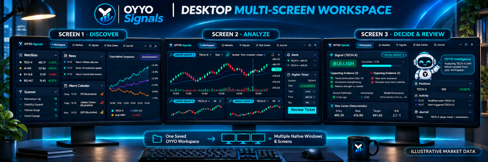
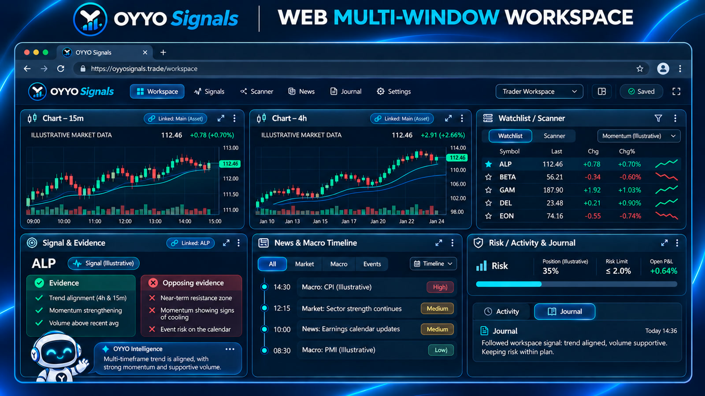
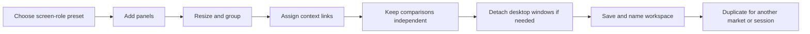

# Multi-screen workspace configurations

OYYO Signals turns screen space into a repeatable trading workflow. The same product contract connects charts, intelligence, evidence, news, scanner results, strategy rules, risk, activity and journal context. Use the web application for configurable browser workspaces; use the desktop application when the workflow benefits from detachable native windows, several monitors, local models and local connectors.

> Illustrative market data is used in the visual above. The layout demonstrates product configuration, not a recommendation or a performance claim.

## The screen-role method

A strong workspace assigns every screen a job:

1. **Discover** — scan markets, watch sessions, compare candidates and monitor news.
2. **Analyze** — inspect structure across linked horizons and test the scenario.
3. **Decide & Review** — read supporting and opposing evidence, check uncertainty and freshness, review risk and record the decision.

More screens should reduce context switching, not multiply noise. Start with the smallest layout that keeps the decision evidence visible.

## Configuration chooser

| Setup | Recommended role map | Best use |
| --- | --- | --- |
| **Laptop / one screen** | One 2×2 workspace with focused/maximized panel switching | Research, travel and review |
| **Ultrawide / wide browser** | Discover left, Analyze center, Decide & Review right | Complete browser workflow without separate windows |
| **Two screens** | Screen 1 Discover + Analyze; Screen 2 Decide & Review | Active research with permanent risk/evidence visibility |
| **Three screens** | Screen 1 Discover; Screen 2 Analyze; Screen 3 Decide & Review | The flagship OYYO trading desk |
| **Four screens** | Three-screen flow plus independent market/session or activity monitor | Multi-market and desk-based monitoring |

## Laptop: focused intelligence

Use a 2×2 grid:

- main chart;
- linked higher-timeframe chart;
- full signal/evidence panel;
- tabbed news, risk and journal panel.

Maximize one panel for detail, then return to the saved grid. Link the two charts and evidence panel to the active symbol. Keep a comparison chart independent when required.

## Ultrawide: the full web workspace

The web application supports a configurable multi-window workspace in a supported browser.

A practical three-column layout:

| Left: Discover | Center: Analyze | Right: Decide & Review |
| --- | --- | --- |
| Watchlist, scanner, news | Main chart, higher horizon, alerts | Evidence, risk/activity, journal |

Save separate workspaces for markets, strategies or sessions. Duplicate a proven arrangement before changing it so the original workflow remains available.

## Dual screen: research and control

**Screen 1 — Discover + Analyze**

- watchlist and scanner;
- main chart;
- linked higher/lower horizons;
- news and macro timeline.

**Screen 2 — Decide & Review**

- complete 13-field OYYO signal;
- supporting and opposing evidence;
- uncertainty, limitations and source freshness;
- model/workflow provenance;
- Risk Center, activity/positions and journal.

This arrangement keeps the control surface visible while the analysis screen changes instruments.

## Three screen: the flagship desk

| Screen | Keep visible | Linking behavior |
| --- | --- | --- |
| **1 · Discover** | Watchlists, scanner, news, macro, cross-market comparison | Scanner can publish a selected symbol to Link Group A; comparison stays independent |
| **2 · Analyze** | Main chart, linked horizons, alerts, eligible review ticket | Charts follow Group A; crosshair/time linking is optional |
| **3 · Decide & Review** | Signal/evidence, freshness, provenance, risk, activity and journal | Research context follows Group A; risk and journal preserve their records |

Desktop users can detach eligible panel groups, move each native window to its display, maximize it and save the arrangement.

## Four screen: add an independent monitor

Add one dedicated screen without breaking the three-role flow. Choose one purpose:

- cross-market and session context;
- positions, transactions and activity;
- news, macro and scheduled events;
- strategy and post-session review.

Keep this screen independent unless synchronization materially helps the workflow.

## Link only what should move together

OYYO supports selective context groups:

- **Symbol** — selected panels follow the same instrument.
- **Horizon** — eligible charts follow the same interval.
- **Crosshair/time** — linked charts align time inspection.
- **Research context** — signal, evidence, news and journal follow the active record.
- **Independent** — a panel preserves its own instrument or horizon for comparison.

A useful default is **Group A** for the main trading question and **Independent** for cross-market confirmation. This prevents one click from replacing every useful comparison.

## Build and save a configuration

Use names that explain the purpose, for example:

- `BTC session — 3 screen`
- `Gold macro — dual screen`
- `FX review — ultrawide`
- `Cross-market confirmation — web`

## What makes the OYYO workspace different

TradingView’s official documentation describes mature saved layouts, synchronized multi-chart analysis and plan-dependent chart counts up to 16. Its desktop documentation also describes multiple windows and multi-monitor workflows. See TradingView’s official guides for [layouts](https://www.tradingview.com/support/solutions/43000746975-tradingview-layouts-a-quick-guide/), [multi-chart analysis](https://www.tradingview.com/support/solutions/43000629990-leveraging-multi-chart-layouts-in-your-analysis/), [desktop](https://www.tradingview.com/desktop/) and [multiple app windows](https://www.tradingview.com/support/solutions/43000611543-how-to-open-multiple-app-windows/).

OYYO’s workspace is designed around a different product contract: charts sit beside required supporting and opposing evidence, uncertainty, freshness, limitations, model/workflow provenance, Strategy Lab, deterministic risk, activity and the trader’s journal. The aim is not simply to show more charts; it is to keep the complete reasoning and control loop visible.

TradingView is a registered trademark of its respective owner. OYYO is not affiliated with TradingView.

## Safety boundary

A saved layout never grants permission to transact. Manual, supervised and automatic actions remain subject to connector eligibility, explicit customer authorization, deterministic risk limits and the kill switch. Market data, paper activity and live-data provenance remain clearly distinguishable.

## Related guides

- [Flagship multi-window workspace](MULTI-WINDOW-WORKSPACE.md)
- [Advanced charts and trader workspaces](CHARTS-AND-WORKSPACES.md)
- [Web, desktop and mobile apps](APPS-AND-PLATFORMS.md)
- [Trading modes and safeguards](TRADING-MODES.md)
- [Broker, MT5 and crypto-exchange connectors](CONNECTORS-AND-VENUES.md)
