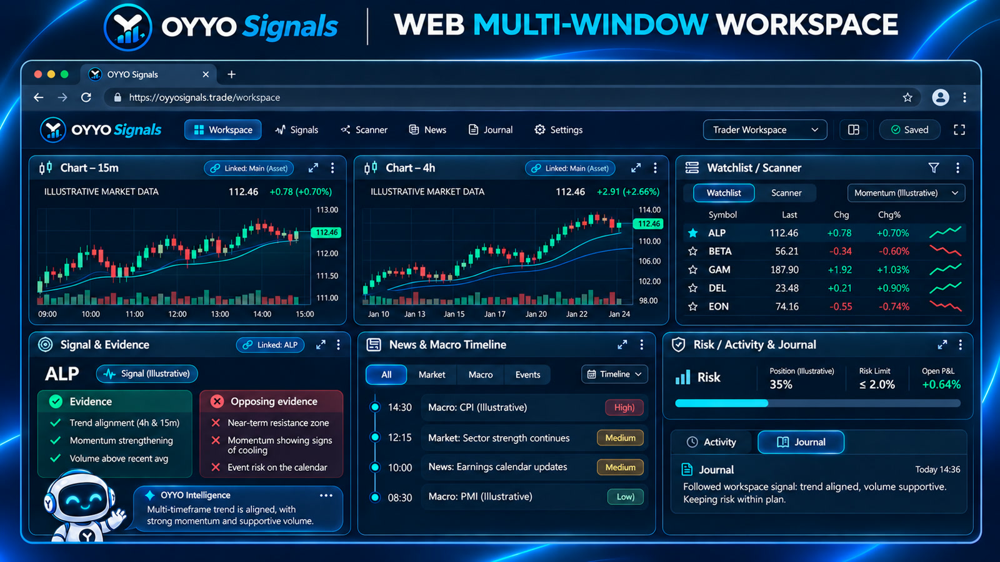
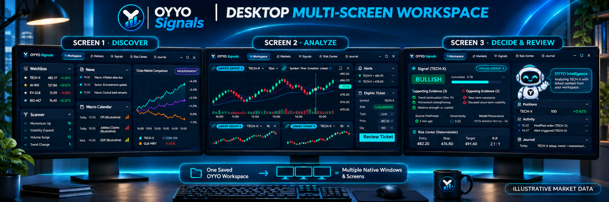
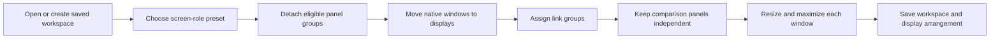
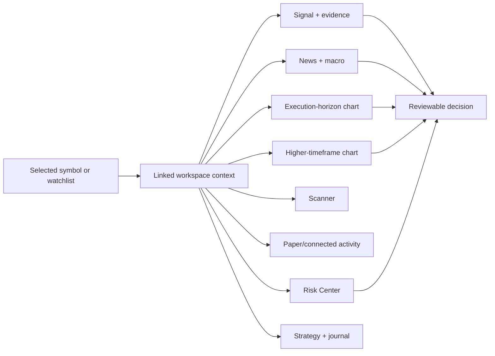

# Multi-window trader workspace

OYYO Trade Signals gives traders a configurable multi-window workspace in both the **web application** and the **desktop application**. It is a flagship product surface: charts, intelligence, evidence, news, scanner results, strategies, activity, risk and journal context can remain visible together instead of being split across unrelated tabs and tools.

## See the workspace

### Web: one browser, one connected research surface

The web example keeps two horizons, scanner/watchlist, full evidence, news/macro, risk/activity and journal visible in one saved browser workspace. Linked badges show which panels follow the active instrument; other panels can remain independent.

### Desktop: one saved workspace across three screens

A practical three-screen configuration:

| Screen | Role | Typical panels |
| --- | --- | --- |
| **1 · Discover** | Find and compare context | Watchlists, scanner, news, macro calendar, independent cross-market comparison |
| **2 · Analyze** | Study price and prepare a scenario | Main chart, linked higher/lower horizons, alerts, reviewable eligible ticket |
| **3 · Decide & review** | Inspect intelligence and control risk | Full evidence/contradiction signal, freshness, uncertainty, model provenance, Risk Center, positions/activity, journal |

The same saved workspace can open as multiple native windows. Move each window to a screen, maximize it, then save the arrangement. Link Group A can synchronize the main symbol/time context across selected panels while the comparison panel remains independent.

## Configuration patterns

| Configuration | Best for | Suggested arrangement |
| --- | --- | --- |
| **Focused laptop** | Research on one screen | 2×2 grid: main chart, higher horizon, evidence, news/risk tabs |
| **Wide-screen web** | Browser-based active research | 3-column grid: charts, intelligence/news, scanner/risk/journal |
| **Dual screen** | Separate discovery from decision | Screen 1 charts/scanner; Screen 2 evidence/news/risk/journal |
| **Three screen** | Full discover → analyze → decide/review flow | Screen 1 discovery; Screen 2 linked charts; Screen 3 intelligence and control |
| **Four screen** | Desk-based multi-market monitoring | Add an independent market/session or activity screen to the three-screen flow |

### Configure multi-screen desktop

1. Start from a saved workspace or a role preset.
2. Group panels by job: Discover, Analyze, Decide & Review.
3. Detach eligible groups into native desktop windows.
4. Move each window to the preferred monitor.
5. Assign symbol, horizon and time links only where synchronization helps.
6. Mark cross-market comparisons as independent.
7. Resize and maximize for the information density of each screen.
8. Save the workspace so the arrangement can be restored.

## Web and desktop availability

| Surface | Multi-window experience |
| --- | --- |
| **Web** | Configurable browser workspace with saved layouts, resizable panels, linked context and browser-accessible research, chart, signal, alert, paper, risk and journal views |
| **Desktop** | The same workspace concept with native multi-window and multi-screen density, detachable views, local models, local connectors and operating-system integration |
| **Mobile** | Focused touch-first views that preserve the same symbols, evidence and workflow concepts without shrinking a desktop grid onto a phone |

The web workspace is not limited to account administration. A trader can configure and use the multi-window research experience directly in a supported browser. Desktop extends that capability for traders who want several native windows, multiple displays and local runtime integrations.

## Why traders use it

A market decision rarely comes from one chart. Traders need to see price action, higher-timeframe structure, news, event risk, current exposure, opposing evidence and the original strategy rules at the same time.

The advantage is not simply “more boxes.” OYYO links panels around the trading question so that a chart movement can be reviewed with its sources, freshness, supporting and opposing evidence, model version, risk envelope and journal history.

## Workspace building blocks

A workspace can combine:

- several advanced charts with independent or linked symbols and horizons;
- watchlists and market/session status;
- the complete 13-field OYYO signal and evidence view;
- source freshness, news, macro events and sentiment;
- scanners and filtered market candidates;
- Strategy Lab rules, scenarios and invalidation conditions;
- paper or eligible connected tickets, activity and positions;
- deterministic risk limits and kill-switch state;
- alerts, journal entries and post-trade review;
- local-model identity, workflow version and provenance.

## Configure a workspace

1. Open **Workspace** in the web or desktop application.
2. Choose a starting layout or create a blank workspace.
3. Add the panels needed for the trading workflow.
4. Resize and arrange panels; desktop users can move eligible views to another window or screen.
5. Link panels by symbol, horizon or a named context group when synchronized navigation is useful.
6. Leave a panel independent when comparing instruments or timeframes.
7. Save the workspace with a clear name such as “BTC session”, “Gold macro” or “FX review”.
8. Reopen, duplicate or revise saved workspaces as the workflow changes.

## What can be configured

- layout grid, row/column proportions and panel size;
- panel type and position;
- saved workspace name, purpose and duplicate;
- symbol, horizon, crosshair/time and research-context link groups;
- independent symbol/horizon per comparison panel;
- chart indicators, overlays, drawings and session context;
- watchlist and scanner filters;
- visible evidence, freshness, news, macro, risk, activity and journal panels;
- desktop native-window placement across available displays;
- focused/maximized view for any selected panel;
- density and accessibility preferences supported by the surface.

## Practical layouts

### One instrument, several horizons

| Panel | Purpose |
| --- | --- |
| Higher-timeframe chart | Regime, structure and major levels |
| Execution-horizon chart | Current session and nearer-term movement |
| Signal and evidence | Supporting/opposing evidence, uncertainty and sources |
| News and macro | Events that may invalidate a purely technical reading |
| Risk and activity | Exposure, limits, paper/eligible connected state |
| Journal | Rationale, decision and later review |

### Cross-market confirmation

Compare an instrument with correlated, competing or risk-sensitive markets while keeping source timestamps and venue identity visible. Each panel can remain independent or join a selected context group.

### Scanner to review

Keep scanner results visible beside a detailed chart, full evidence panel and strategy rules. A scanner match is only a research candidate; it does not become a recommendation.

### Position and risk review

Keep transactions, derived positions, deterministic risk limits, alerts and the original signal record together. This makes it easier to compare the current state with the assumptions that existed when the scenario was created.

## Linked context without forced synchronization

OYYO supports deliberate linking:

- **Symbol link:** selected panels follow the same instrument.
- **Horizon link:** selected charts follow the same interval/horizon.
- **Crosshair/time link:** eligible charts align time inspection.
- **Research link:** signal, evidence, news and journal follow the active context.
- **Independent panel:** a panel keeps its own symbol or horizon for comparison.

The trader chooses which panels move together. One global setting does not have to control every chart and research view.

## OYYO and chart-first platforms

TradingView is a registered trademark of its respective owner. The comparison below describes workflow emphasis, not an affiliation or a claim that one tool is best for every trader. TradingView’s official documentation describes saved layouts, synchronized multi-chart views and plan-dependent layouts of up to 16 charts. See its official guides for [layouts](https://www.tradingview.com/support/solutions/43000746975-tradingview-layouts-a-quick-guide/), [multi-chart analysis](https://www.tradingview.com/support/solutions/43000629990-leveraging-multi-chart-layouts-in-your-analysis/) and [layout/chart behavior](https://www.tradingview.com/support/solutions/43000692404-layouts-charts-drawings-indicators-and-their-interaction/).

| Workflow need | OYYO Trade Signals | TradingView / chart-first workflow |
| --- | --- | --- |
| Multiple charts in one layout | Web and desktop configurable workspaces | Mature multi-chart layouts; chart count depends on plan |
| Symbol, horizon and time linking | Selective context groups across eligible panels | Symbol, interval, crosshair, time and date-range synchronization |
| Beyond-chart panels | Native signal evidence, sources, uncertainty, scanner, Strategy Lab, risk, activity and journal | Primarily charting, market analysis, alerts, community and supported broker/paper workflows |
| Explainable intelligence | Required supporting/opposing evidence, freshness, limitations, model/workflow version and provenance | Not the purpose of the chart-layout contract |
| Research-to-review continuity | Signal → strategy → alert/ticket → risk → activity → journal in one product contract | Traders can combine charts and trading features; broader review workflow depends on their setup |
| Local intelligence and connectors | Desktop can combine qualified local models and customer-controlled local connector boundaries | Uses its own web/desktop/mobile platform and supported integrations |
| Browser workspace | Full OYYO research workspace in the web app | Full browser charting experience |
| Native multi-screen use | Desktop extends layouts across native windows and screens | TradingView Desktop supports linked tabs/windows and multi-monitor workflows |

OYYO is not trying to win by displaying the largest possible number of charts. Its differentiator is connecting the chart to evidence, contradiction review, model provenance, risk, activity and the trader’s own journal.

## Advanced charts

Charts support multiple horizons, indicators, overlays, drawings, saved views, market/session context and movement between chart, research, alerts, strategy, paper/eligible connected workflows and journal.

Every chart remains dependent on its data source. Venue, provider, symbol, quote currency, source time, received time and freshness should remain inspectable. A sophisticated layout cannot make stale or incomplete data reliable.

## Persistence and safety

- Workspaces are saved under an authenticated customer context.
- Local connector credentials remain in the device secure store and are not embedded in a workspace.
- A layout does not grant trading permission.
- Manual, supervised or automatic action remains subject to connector eligibility, customer permissions, deterministic limits and kill switch.
- Simulated, paper and live-data provenance remain distinguishable.
- Deleting or replacing a layout does not rewrite the provenance of saved observations or journal records.

## FAQ

### Is multi-window available on web?

Yes. The browser application supports configurable multi-window workspaces. Desktop adds native multi-window, multi-screen and local-runtime depth.

### Do all panels have to follow the same symbol?

No. Link only the panels that should share context; keep others independent for comparison.

### Is this only a chart grid?

No. Charts can sit beside evidence, news, scanners, strategy rules, positions/activity, risk controls and journal history.

### Does opening a trading panel authorize an order?

No. Workspace configuration never replaces explicit connector permission, customer authorization or deterministic risk controls.

### Can I save different setups?

Yes. Save layouts by market, strategy, session or review purpose, then duplicate and adapt them.

## Related guides

- [Advanced charts and trader workspaces](CHARTS-AND-WORKSPACES.md)
- [Web, desktop and mobile apps](APPS-AND-PLATFORMS.md)
- [Signals, models and provenance](SIGNALS-AND-MODELS.md)
- [Trading modes](TRADING-MODES.md)
- [Connectors and venues](CONNECTORS-AND-VENUES.md)
- [Trader manual](TRADER-MANUAL.md)
