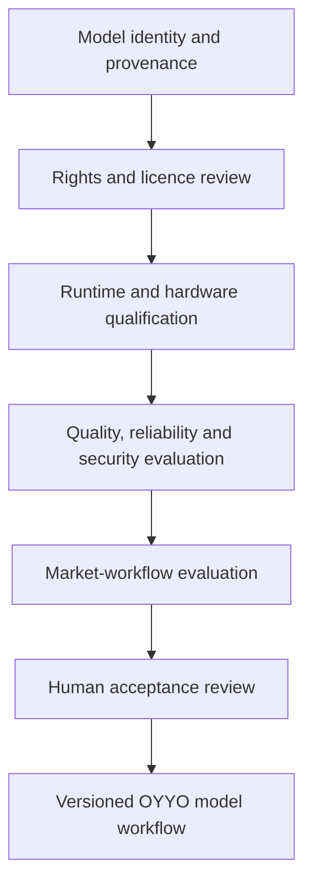

# Signals, models and provenance

## The thirteen-field output contract

| Field | Meaning |
| --- | --- |
| `timestamp` | When the observation was produced |
| `horizon` | Time horizon selected for the analysis |
| `instrument` | Market instrument being observed |
| `market_state_label` | Descriptive `bullish`, `bearish` or `neutral` state |
| `uncertainty` | Explicit uncertainty statement or measure |
| `sources` | Named inputs used for the observation |
| `data_freshness` | Age and timestamp context for inputs |
| `supporting_evidence` | Evidence consistent with the observed state |
| `opposing_evidence` | Evidence challenging the observed state |
| `limitations` | Known data, method and scope limitations |
| `model_version` | Exact model/workflow version used |
| `provenance` | `simulated`, `paper` or `live-data` |
| `notice` | Informational market analysis — not an instruction to transact. |

Personal wealth, income, investment objectives, risk tolerance and portfolio suitability are not used to turn market-state observations into personal recommendations.

## Model quality pipeline

The dedicated [OYYO-SIGNALS-TINY-ALL model page](OYYO-SIGNALS-TINY-ALL.md) documents the S1–S4 profiles, device selection, integrity checks, agent flow, output contract and release-specification boundaries.

OYYO model catalogs describe identity, capabilities and requirements. Availability in Trade Signals depends on device qualification and the versioned product workflow. See [OYYO Models](https://github.com/vpicciuolo/oyyo-models) and [OYYO Benchmark](https://github.com/vpicciuolo/oyyo-benchmark).

## Reproducible identity

A saved observation can retain:

- application and platform version;
- model identity and exact revision;
- quantization or conversion identity;
- runtime/backend version;
- workflow and signal-contract version;
- source/provider identifiers and timestamps;
- result provenance;
- configuration relevant to the observation.

## Interpretation

- A label summarizes configured analysis; it does not replace evidence.
- Uncertainty is part of the output.
- Stale or missing data remains visible.
- Conflicting evidence remains visible.
- Model/workflow changes are versioned.
- Simulated and paper results are never represented as live performance.
