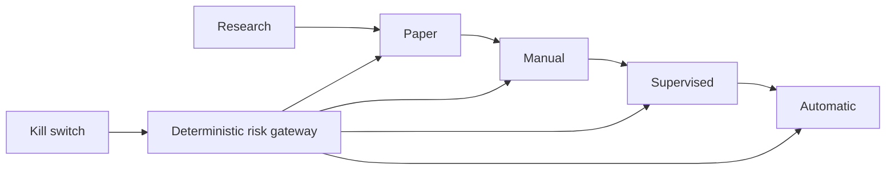

# Trading and research modes

OYYO Trade Signals separates research, simulation and customer-controlled venue activity into five explicit modes. The active mode is always visible. Availability depends on the installed app, account entitlement, region, connector, device security and customer configuration.

## Research mode

For observation, charts, scanners, news, evidence, AI research, strategy notes, alerts and journaling. Research outputs cannot place an order.

**Customer remains responsible for:** verifying source freshness, limitations, market conditions and the suitability of any independent decision.

## Paper mode

For simulated tickets, fills, fees, transactions, positions and strategy review. Paper mode connects research to a ledger without sending a real order.

**Important:** paper performance can differ materially from live activity because of liquidity, latency, spreads, slippage, partial fills, fees, market impact and provider differences.

## Manual mode

The customer reviews the complete ticket and personally confirms the exact action through an eligible customer-controlled local connector. OYYO can prepare context and validate deterministic limits, but the customer makes the final submission decision.

**Controls:** visible venue/account, instrument, side, type, quantity, price constraints, estimated notional, risk result and final confirmation.

## Supervised mode

OYYO can prepare a typed order intent from a customer-defined strategy. The exact intent remains pending until the customer reviews and approves it. Changes after approval invalidate the approval and require a new review.

**Controls:** explicit approval, expiry, connector identity, strategy identity, deterministic risk checks, duplicate protection, audit record and kill switch.

## Automatic mode

A customer-defined strategy can create eligible intents inside fixed local limits. Automatic mode remains customer-controlled: it is explicitly enabled, bounded to selected venues/instruments/strategies, subject to deterministic risk and stopped by the kill switch.

**Controls:** opt-in activation, allowed venue/account/instruments, maximum notional, daily loss, position and frequency limits, stale-data rejection, connector health, authorization expiry, audit trail and immediate stop.

## Modes never bypass safeguards

An AI component may produce research or a typed intent; it cannot bypass the deterministic risk gateway, connector permissions, account authorization, device security, region rules, mode entitlement or kill switch. OYYO does not custody money, assets, private keys or venue credentials, and the OYYO cloud does not operate a customer account.

## Universal risk disclaimer

No mode guarantees availability, execution, fill price, profit or protection from loss. Manual confirmation does not remove market risk. Supervision does not make an output a personal recommendation. Automation can amplify configuration, data, model, connectivity and market errors. Customers should use limits they understand, monitor active systems and keep an independent venue-level emergency stop.
