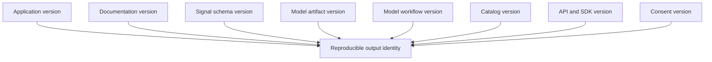

# OYYO Trade Signals versioning

OYYO uses separate versions for separate responsibilities so customers can identify the exact product, model and contract behind an output.

## Version families

| Surface | What the version identifies |
| --- | --- |
| Application | Customer-facing desktop or mobile build |
| Public documentation | Information set in this repository |
| Signal schema | Required fields and interpretation rules |
| Model artifact | Exact model identity, revision and checksum |
| Model workflow | Analysis, preprocessing, tools and synthesis contract |
| Catalog | Independently versioned roles, tasks, styles and metadata |
| API/SDK | Public developer interface contract |
| Legal consent | Exact customer terms and policy revision accepted |

## Semantic versions

- **Major** identifies an incompatible contract change.
- **Minor** adds compatible functionality.
- **Patch** corrects or hardens an existing contract.

Catalogs can use date-based versions. Model artifacts also retain provider identity, revision, conversion details and checksum.

## Current public versions

- Android application: `0.8.0`
- OYYO-SIGNAL-TINY-ALL: `2026.11.1`
- Documentation: `1.1.0`
- Signal contract: `signals.output.v1`

Platform download pages and signed release records identify the exact artifact for each supported device.
